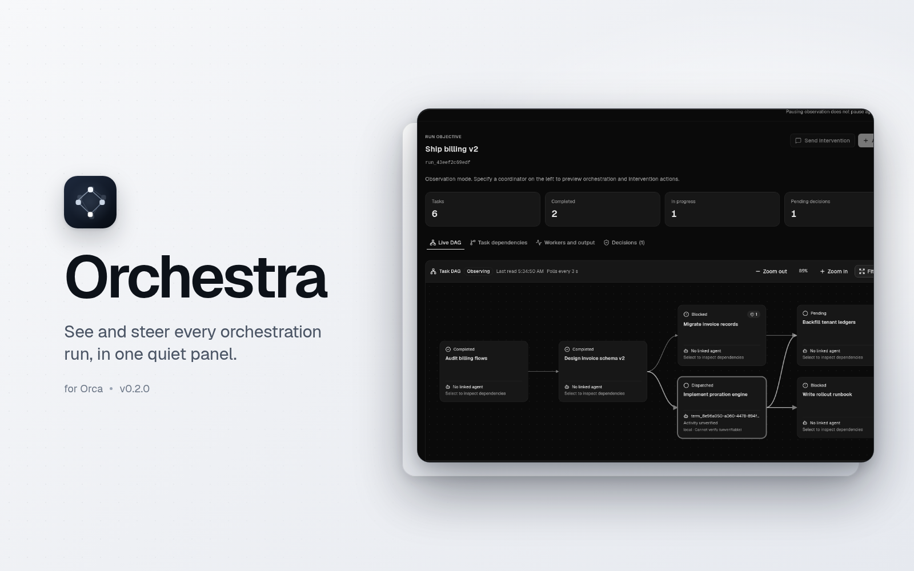
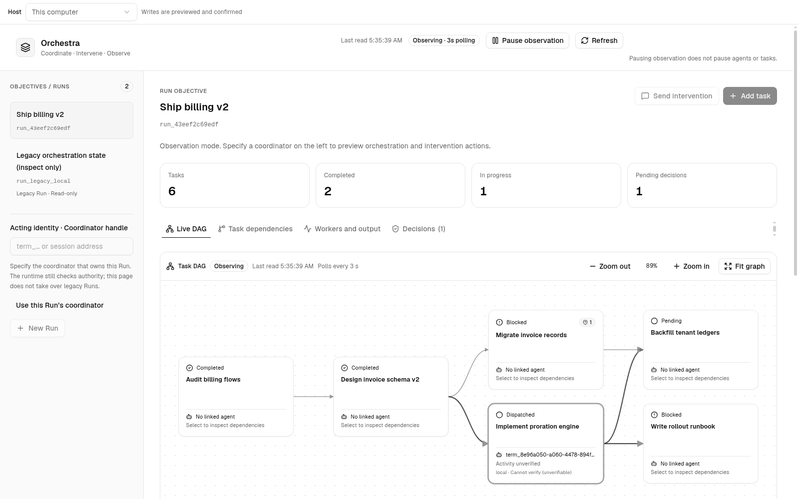
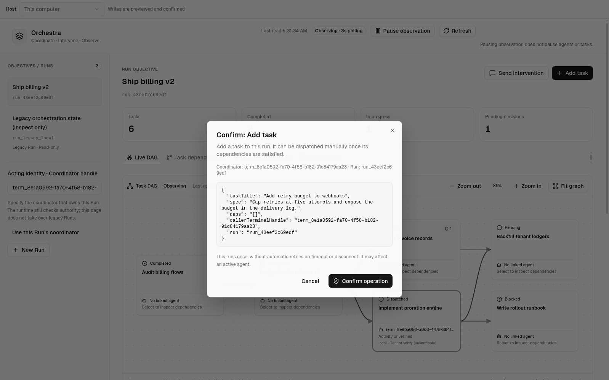
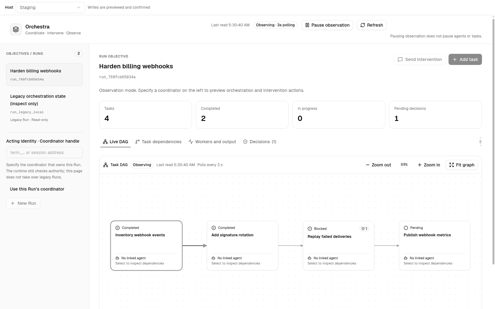

# Orchestra for Orca

**See and steer every Orca orchestration run — from one quiet panel.**

Orchestra puts the whole collaboration in one place: the task graph, every run and task, the
agent and host behind each dispatch, pending decisions, and worker output. Writes never happen
behind your back — each one is previewed with its exact target, confirmed by you, and leaves a
receipt.

## Install

**Requires Orca desktop 1.4.246 or newer.**

1. Open **Settings → Plugins** and turn plugins on if they are off.
2. Choose **Add plugin → From a Git URL…** and enter
   `https://github.com/JonesZeng/orca-orchestra.git#v0.2.2`.
3. Review the **trusted-worker** access, approve it, then open **Orchestra** in the right sidebar.

Orca names this install `joneszeng.orchestra`. To install offline, download
`orchestra-0.2.2.zip` from the releases page, verify its `.sha256`, extract it, and use
**Add plugin → From a folder…** on the folder that directly contains `orca-plugin.json`.

## What you get

- **Live DAG and board.** Tasks, dependencies, readiness and mixed states, refreshed every three
  seconds.
- **Runs, tasks, workers, decisions.** One panel for the coordinator's whole view.
- **Previewed writes.** Create a run or task, dispatch a ready task, send an intervention, or
  resolve a decision — every write shows its target and parameters first.
- **Remote servers.** Switch the **Host** selector between this computer and any server you have
  already saved in Orca.
- **Native feel.** Follows Orca's light and dark themes, English and Simplified Chinese.

| Live DAG                                                                          | Preview before send                                                        |
| --------------------------------------------------------------------------------- | -------------------------------------------------------------------------- |
|  |  |

## Remote servers

The **Host** selector lists the servers saved in Orca under **Settings → Remote Orca Servers**. Reads and
confirmed writes go directly to the selected server over its saved end-to-end-encrypted pairing.
Tunnel-backed servers work while Orca keeps their tunnel open.

## Security

- Every write is previewed with its exact target and parameters, then confirmed. A lost reply
  shows a request id; Orchestra never retries a write by itself.
- **`trusted-worker` is full access.** The worker runs as a separate Node process with your user
  permissions, outside Orca's sandbox. Install only from a source you trust.
- The panel receives run data only — never pairing tokens, endpoints or host keys. The worker
  connects only to servers already saved in Orca.
- No telemetry and no external requests; the panel is one self-contained HTML file. Read the full
  model in [docs/SECURITY.md](docs/SECURITY.md).

## Troubleshooting

| What you see                                    | Fix                                                                                                     |
| ----------------------------------------------- | ------------------------------------------------------------------------------------------------------- |
| “No readable orca-plugin.json was found”        | Choose the folder that directly contains `orca-plugin.json` — the extracted zip's root, not its parent. |
| The panel says to approve the plugin            | Turn on plugins, approve the `trusted-worker` review, enable Orchestra, then reopen the panel.          |
| The run list is empty                           | Start an orchestration run in Orca, or switch **Host** back to **This computer**.                       |
| A saved server is unreachable                   | Open that server in Orca once so its tunnel is running, then retry.                                     |
| “This server does not support remote Orchestra” | Update Orca on that server to 1.4.246 or newer.                                                         |

## Build from source

The repository root is the release folder. See [docs/DEVELOPMENT.md](docs/DEVELOPMENT.md) for the
build, the package contents, reproducibility, publishing and the release checklist.
[`source/`](source/README.md) rebuilds both bundles, byte for byte, from the pinned Orca commit.

## License

MIT. Bundled third-party code and fonts are covered by
[THIRD_PARTY_NOTICES.md](THIRD_PARTY_NOTICES.md).

[中文说明](README.zh-CN.md)
