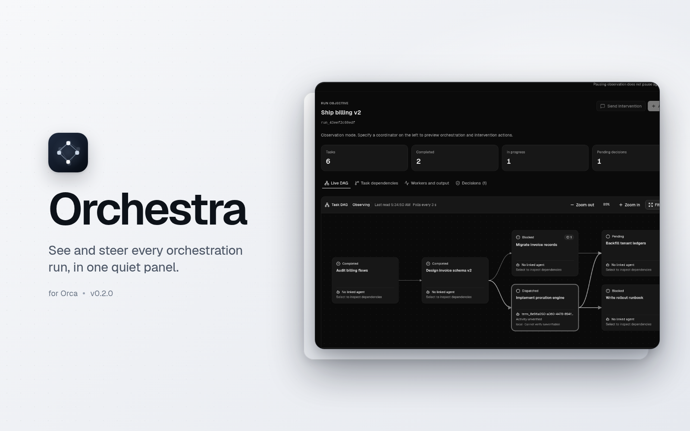
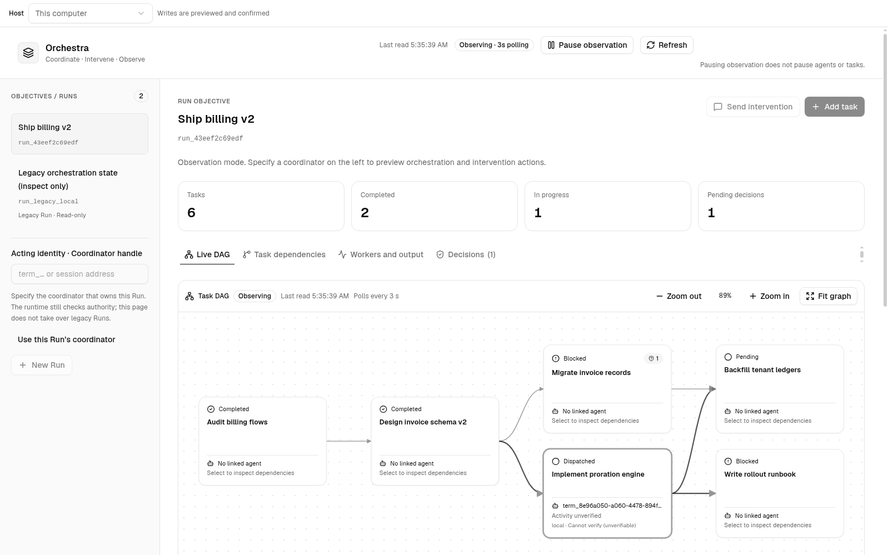
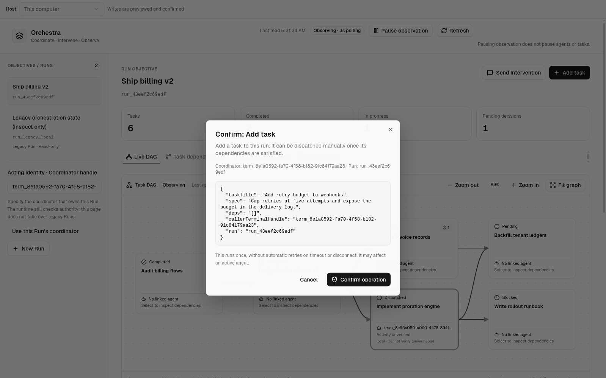
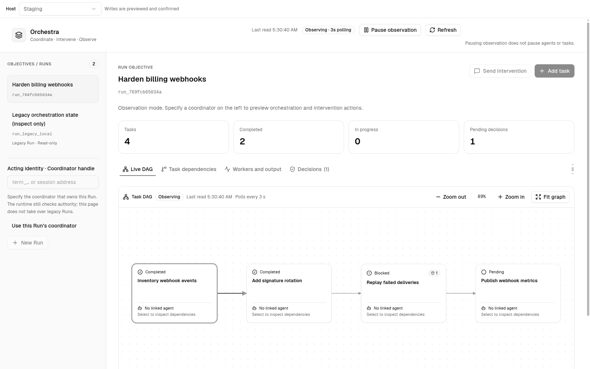

# Orchestra for Orca

**在一个安静的面板里，看清并掌控每一个 Orca 编排运行。**

Orchestra 把整个协作过程放在一处：任务图、每一次运行与任务、每次派发背后的 agent 与主机、
待处理决策，以及 worker 输出。写操作绝不悄悄发生——每次都会先展示准确目标，由你确认，
并留下回执。

## 安装

**需要 Orca 桌面版 1.4.246 或更新版本。**

1. 打开 **设置 → 插件**，如插件尚未开启请先开启。
2. 选择 **添加插件 → 从 Git URL…**，输入
   `https://github.com/JonesZeng/orca-orchestra.git#v0.2.2`。
3. 审阅 **trusted-worker** 权限，批准后从右侧边栏打开 **Orchestra**。

Orca 会将此次安装命名为 `joneszeng.orchestra`。离线安装：从 Releases 下载
`orchestra-0.2.2.zip`，校验 `.sha256` 后解压，再用 **添加插件 → 从文件夹…** 选择直接包含
`orca-plugin.json` 的那一层文件夹。

## 你能得到什么

- **实时 DAG 与看板。** 任务、依赖、就绪状态与混合状态，每三秒刷新。
- **运行、任务、worker、决策。** 一个面板呈现协调者的全部视图。
- **先预览，后写入。** 创建运行或任务、派发就绪任务、发送干预或解决决策——每次写入都会
  先展示目标与参数。
- **远程服务器。** 在 **主机** 选择器中，在本机与已在 Orca 中保存的服务器之间切换。
- **原生体验。** 跟随 Orca 的明暗主题、英文与简体中文。

| 实时 DAG                                                              | 发送前预览                                                   |
| --------------------------------------------------------------------- | ------------------------------------------------------------ |
|  |  |

## 远程服务器

**主机** 选择器列出 **设置 → 远程 Orca 服务器** 中已保存的服务器。读取与确认后的写入会通过已保存的
端到端加密配对直接发送到所选服务器。隧道服务器需在 Orca 中保持隧道开启。

## 安全

- 每次写入都会先展示准确目标与参数，再由你确认。回执丢失时会显示请求 ID；Orchestra
  绝不自动重试写入。
- **`trusted-worker` 拥有完整权限。** worker 以独立 Node 进程、你的用户权限运行在 Orca
  沙箱之外。只安装你信任来源的插件。
- 面板只接收运行数据，绝不含配对令牌、端点或主机密钥。worker 只连接 Orca 中已保存的服务器。
- 无遥测、无外部请求；面板是一个自包含 HTML 文件。完整模型见
  [docs/SECURITY.md](docs/SECURITY.md)。

## 故障排查

| 现象                                            | 处理                                                                         |
| ----------------------------------------------- | ---------------------------------------------------------------------------- |
| “No readable orca-plugin.json was found”        | 选择直接包含 `orca-plugin.json` 的文件夹——解压后的根目录，而不是它的上一层。 |
| 面板提示需要批准插件                            | 开启插件，批准 `trusted-worker` 审阅，启用 Orchestra，然后重新打开面板。     |
| 运行列表为空                                    | 在 Orca 中启动一个编排运行，或将 **主机** 切回 **本机**。                    |
| 已保存的服务器无法连接                          | 先在 Orca 中打开该服务器以保持隧道运行，然后重试。                           |
| “This server does not support remote Orchestra” | 将该服务器上的 Orca 更新到 1.4.246 或更新版本。                              |

## 从源码构建

仓库根目录就是发布目录。构建、包内容、可复现性、发布与发布检查清单见
[docs/DEVELOPMENT.md](docs/DEVELOPMENT.md)。
[`source/`](source/README.md) 可从固定的 Orca 提交逐字节重建两个 bundle。

## 许可证

MIT。随包的第三方代码与字体见 [THIRD_PARTY_NOTICES.md](THIRD_PARTY_NOTICES.md)。

[English](README.md)
